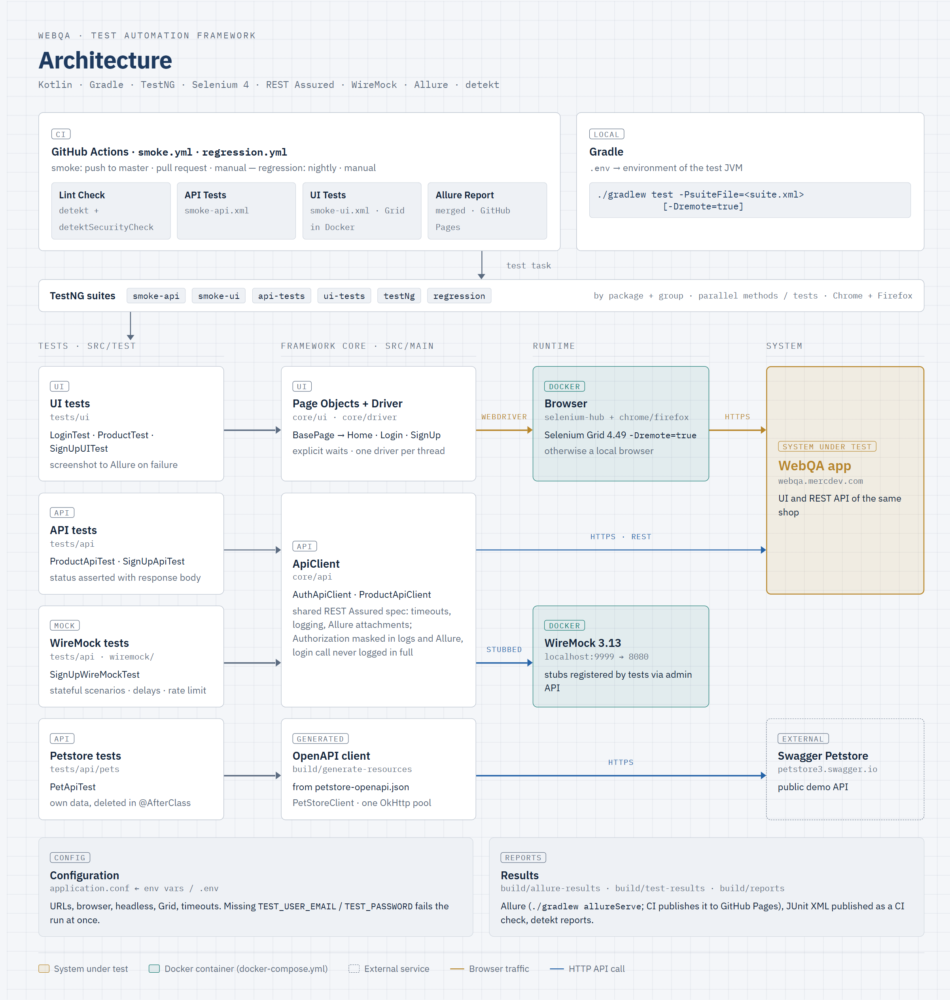

# WebQA Test Automation Framework

[](https://github.com/maksimTrs/WebQA/actions/workflows/smoke.yml)
[](https://maksimtrs.github.io/WebQA/)

UI and API test automation for the WebQA demo shop, written in Kotlin on TestNG, Selenium WebDriver and REST Assured.

## Architecture

<picture>
  <source media="(prefers-color-scheme: dark)" srcset="docs/architecture-dark.png">
  
</picture>

<sub>Source: <code>docs/architecture.html</code>. After editing it, re-take both PNG screenshots of <code>.frame</code> (light and dark color scheme, 2x).</sub>

- **UI**: page objects on explicit waits (`WebDriverWait`, no implicit waits). One driver per thread, so suites run in parallel. Chrome or Firefox, locally or on Selenium Grid. A screenshot is attached to Allure when a test fails.
- **API**: one `ApiClient` base for all clients. It applies timeouts and logging, and every call is attached to Allure. The `Authorization` header is masked in logs and in Allure. The login call carries the password in and the token out, so only its URI and status are logged, and it is not attached.
- **Mocks**: the same client can point at a WireMock container, which serves stateful scenarios, delays and rate limiting (`SignUpWireMockTest`).
- **Petstore**: a client generated from `petstore-openapi.json` by OpenAPI Generator. Tests delete the pets they create. They target the public demo by default; `docker compose up -d --wait petstore` plus `PETSTORE_BASE_URL=http://localhost:8085/api/v3` runs them against a local copy.
- **Config**: `application.conf` (Typesafe Config) with environment-variable overrides. A test that logs in fails at once with a clear message if `TEST_USER_EMAIL` / `TEST_PASSWORD` is missing; tests that do not log in (sign-up, Petstore, WireMock) run without them.
- **Suites**: TestNG suites select tests by package and group (`smoke`, `wiremock`), not by class or method name, so a new or renamed test stays in its suites.

Stack: Kotlin · Gradle · TestNG · Selenium 4 · REST Assured · WireMock · AssertJ · Allure · DataFaker · detekt.

## Setup

1. JDK 17 or newer to run Gradle. The tests are compiled and run on a JDK 17 toolchain, which Gradle downloads if the machine has none.
2. Chrome or Firefox for local UI runs. Docker for Selenium Grid and WireMock.
3. Credentials for the test stand:
   ```bash
   cp .env.example .env   # then set TEST_USER_EMAIL and TEST_PASSWORD
   ```
   Gradle passes `.env` to the tests. Real environment variables take precedence. Optional overrides (browser, URLs, headless, Grid URL, timeouts) are listed in `.env.example`.
4. Git hooks (once per clone):
   ```bash
   git config core.hooksPath .githooks
   ```
   `pre-commit` checks that files with `@Test` are named `*Test.kt`. `pre-push` runs the same detekt checks as the CI Lint Check job.

## Running tests

```bash
# One class / one suite
./gradlew test --tests com.webqa.tests.ui.LoginTest
./gradlew test -PsuiteFile=src/test/resources/api-tests.xml

# Headless
WEBDRIVER_HEADLESS=true ./gradlew test -PsuiteFile=src/test/resources/smoke-ui.xml
```

| Suite (`src/test/resources/`) | Content |
|---|---|
| `smoke-api.xml`, `smoke-ui.xml` | Group `smoke`: critical path. Used by CI |
| `api-tests.xml` | WebQA API and Petstore tests |
| `ui-tests.xml` | UI tests in Chrome and Firefox in parallel |
| `testNg.xml` | All tests except group `wiremock` |
| `regression.xml` | Everything, including WireMock (needs the container) |

### Selenium Grid

```bash
docker compose up -d --wait selenium-hub chrome firefox   # --wait: until a node has registered
./gradlew test -PsuiteFile=src/test/resources/ui-tests.xml -Dremote=true
```

Grid UI: http://localhost:4444/ui. Watch a browser over VNC: Chrome at http://localhost:7900, Firefox at http://localhost:7901 (no password). All ports are bound to `127.0.0.1`, so they are not reachable from the network.

### WireMock

```bash
docker compose up -d --wait wiremock      # host port: WIREMOCK_PORT, default 9999
./gradlew test --tests com.webqa.tests.api.SignUpWireMockTest
```

The tests register their own stubs via the admin API and reset WireMock before and after the class, so `wiremock/mappings` can stay empty and an interrupted run leaves no state behind.

## Reports

```bash
./gradlew allureServe     # build and open the Allure report (allureReport only builds it)
```

Raw results are written to `build/allure-results`, JUnit XML to `build/test-results/test`. CI publishes the report of the latest `master` run, with trends, to [GitHub Pages](https://maksimtrs.github.io/WebQA/).

## Static analysis

```bash
./gradlew detekt detektSecurityCheck
```

Both tasks fail on any finding (`maxIssues: 0`). Reports are written to `build/reports/detekt/`. Config: `config/detekt/detekt.yml` (only the deviations from the detekt defaults) and `detekt-security.yml`.

## CI

`.github/workflows/smoke.yml` runs on pushes to `master`, on pull requests and manually:

- **Lint Check**: detekt.
- **API Tests**: `smoke-api.xml`.
- **UI Tests**: `smoke-ui.xml` on Selenium Grid in Docker.
- **Allure Report**: merges the results of both test jobs into one report, uploaded as an artifact. On `master` it is deployed to GitHub Pages.

`.github/workflows/regression.yml` runs `regression.xml` on manual dispatch only (the shared stand is too unstable for a schedule): UI tests in Chrome and Firefox on Grid, API tests including WireMock and Petstore in local containers.

Credentials come from the `TEST_USER_EMAIL` and `TEST_PASSWORD` secrets. Pull requests from forks get no secrets, so they run only the lint. A newer push to a pull request cancels its outdated run; runs on `master` queue instead, so a Pages deployment is never cut off. Test and Grid reports are uploaded as artifacts when a job fails. Gradle runs through `gradle/actions/setup-gradle`, which caches dependencies and validates the wrapper jar.

Dependabot (`.github/dependabot.yml`) proposes weekly updates of the version catalog, the pinned actions and the Docker images: one grouped pull request per ecosystem for minor and patch versions, majors one by one.
